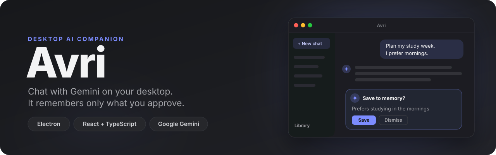
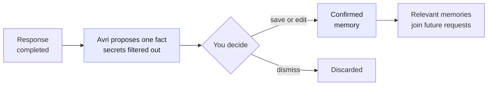
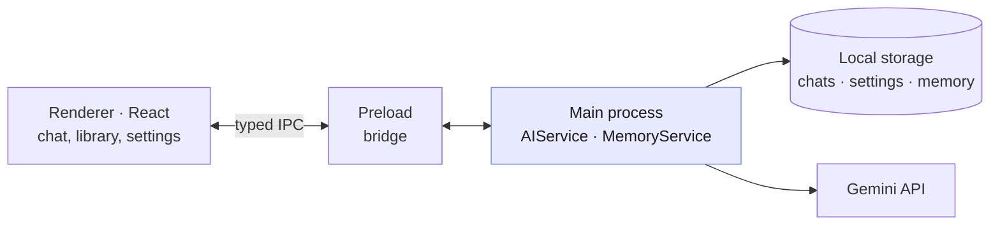

<div align="center">



<br>

<a href="https://github.com/YelzhasTem/Avri/releases/latest"></a>

<br><br>

<a href="https://github.com/YelzhasTem/Avri/actions/workflows/ci.yml"></a>


<p>
  <a href="#download">Download</a> ·
  <a href="#features">Features</a> ·
  <a href="#how-memory-works">Memory</a> ·
  <a href="#architecture">Architecture</a> ·
  <a href="#getting-started">Getting started</a>
</p>

</div>

## About

**Avri** is a personal AI assistant that lives on your desktop. It streams answers from Google Gemini, keeps your chats on your own computer and can remember useful facts about you, but only the ones you approve.

## Download

Get the latest installer from **[Releases](https://github.com/YelzhasTem/Avri/releases/latest)**.

| System | File | First launch |
| --- | --- | --- |
| macOS (Apple silicon) | `Avri-…-mac-arm64.dmg` | The app is not signed yet. Drag Avri to Applications, then right-click it → **Open** → **Open**. If macOS still blocks it: System Settings → Privacy & Security → **Open Anyway** |
| macOS (Intel) | `Avri-…-mac-x64.dmg` | Same as above |
| Windows 10/11 | `Avri-…-win-x64.exe` | SmartScreen may warn about an unknown publisher: **More info** → **Run anyway** |
| Linux | `Avri-…-linux-x86_64.AppImage` | Run `chmod +x Avri-*.AppImage`, then open it |

On first launch Avri asks for a Gemini API key. [Creating one](https://aistudio.google.com/apikey) is free; paste it in **Settings**.

## Features

<table>
<tbody>
<tr valign="top">
<td width="50%">

### Fast, interruptible chat
Answers stream in as they are generated. A stop button cancels a response mid-way, and failed requests are retried automatically when it is safe to do so.

</td>
<td width="50%">

### Memory you control
After a response, Avri may suggest one durable fact to remember. Nothing is saved until you confirm it. In the **Library** you can search, filter, edit and archive memories, or clear them all.

</td>
</tr>
</tbody>
<tbody>
<tr valign="top">
<td>

### Local-first
Chats, settings and memories are stored in Electron's application data folder on your machine.

</td>
<td>

### Safe key handling
The Gemini API key stays in the Electron main process and never reaches the UI bundle. A key saved in Settings is encrypted with the operating system's secure storage.

</td>
</tr>
</tbody>
<tbody>
<tr valign="top">
<td>

### Model choice
Pick a Gemini model in Settings and test the connection with one click.

</td>
<td>

### Light and dark themes
Follows your system theme or stays in the theme you choose.

</td>
</tr>
</tbody>
<tbody>
<tr valign="top">
<td>

### Readable answers
Replies render as Markdown: headings, lists, tables and code blocks with a one-click **Copy** button. Links open in your browser, never inside the app.

</td>
<td>

### Guided first run
Without a key, Avri explains what it needs and links straight to a free Gemini key instead of failing on the first message.

</td>
</tr>
</tbody>
</table>

## How memory works



- Obvious secrets and highly sensitive data are rejected twice: before extraction and again before saving.
- Memories are kept separately from chat history, in a versioned local store that recovers from corrupted files.
- Only a small, relevant set of confirmed memories is added to each request, so the context stays focused.

## Architecture



The renderer runs with context isolation on and Node integration off. It has no direct access to the AI SDK and talks to the main process only through a typed preload bridge.

| Path | Responsibility |
| --- | --- |
| `src/services/ai` | Provider contract, shared models and errors, Gemini implementation |
| `src/services/memory` | Provider-independent memory policy, validation and retrieval |
| `src/services/markdown` | Markdown parser for replies: raw HTML stays text, only http(s) links survive |
| `src/services/links.ts` | Which links may leave the app and open in the system browser |
| `src/hooks` | Streaming and local chat state for React |
| `src/components` | Chat, history, memory and settings views |
| `electron/main` | Gemini requests, cancellation, retries, credentials, IPC handlers |
| `electron/main/storage` | Replaceable local repositories for chats and settings |
| `electron/main/memory` | Memory persistence and non-blocking extraction |
| `electron/preload` | The bridge exposed to the renderer |
| `electron-builder.yml`, `resources/` | Installer configuration and app icons |
| `.github/workflows` | CI on every pull request; installers and a GitHub release for every `v*` tag |

## Getting started

**Requirements:** Node.js 20.19+ and npm.

```bash
npm install
cp .env.example .env    # add your GEMINI_API_KEY
npm run dev
```

You can also skip the `.env` file and paste a key in **Settings** → **Test connection**. A key saved in Settings takes priority over the `.env` key.

| Command | What it does |
| --- | --- |
| `npm run dev` | Run the app with hot reload |
| `npm run build` | Type check and build |
| `npm run preview` | Run the production build |
| `npm test` | Unit tests: memory policy and storage, Markdown parser, link safety, API key status |
| `npm run dist` | Build an installer for the current system into `release/` |
| `npm run dist:mac` · `dist:win` · `dist:linux` | Build for a specific system |

### Releasing

1. Bump `version` in `package.json` and merge it into `main`.
2. Open **Actions → Release → Run workflow** on `main`. It creates the `v<version>` tag for you.

Pushing a matching tag works too: `git tag v0.1.0 && git push origin v0.1.0`.

GitHub Actions builds the macOS, Windows and Linux installers and publishes them as a GitHub release.

---

<div align="center">
<sub>Built by <a href="https://github.com/YelzhasTem">Yelzhas</a>.</sub>
</div>
